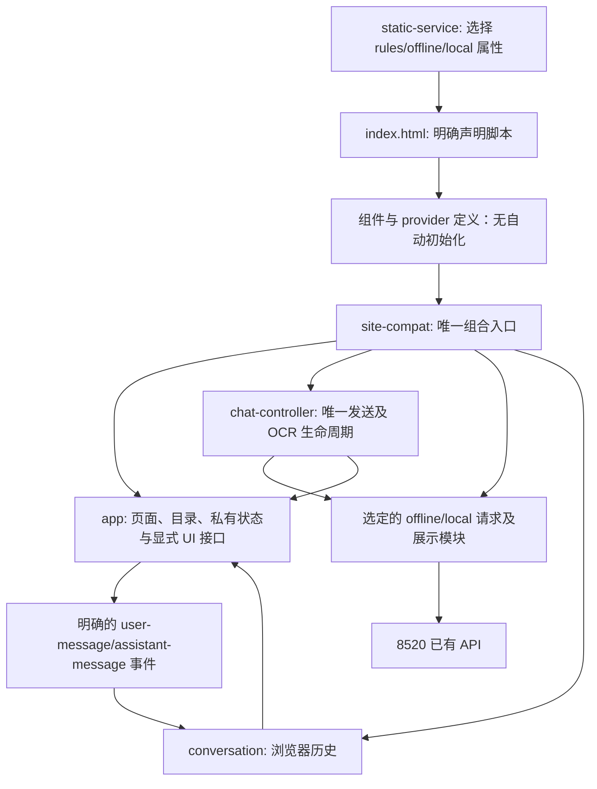

# V2 前端结构治理交付（2026-10-18）

本轮治理结构，未重新设计 UI。成功标准是消除重复发送、隐式模块依赖和运行时函数覆盖，不按删除文件数或代码行数计分。

## 基线与提交边界

- 工作区：`work/v2-frontend`。
- 治理前 HEAD：`87f2445d5ac47a0f11f2639ab175aa5bb6c43f2b`。
- 可恢复检查点：`checkpoint/v2-frontend-governance-20261018-87f2445`；共享交接还保留 f87402d/f075e31 检查点。
- 第一提交 `1524691`：统一消息/OCR 生命周期、模块依赖、消息事件和会话身份。
- 第二提交 `ead61c5`：单独治理静态加载，含三种模式和代理隔离验证。
- 最后提交：目录请求复用、两条无效 CSS、补充验收及本说明，见本分支 Git 记录。
- 未 push、未部署、未操作 V1。只重启了 8620 前端代理，未启停 8520、索引、飞书或模型。

期间其它窗口在同一工作树追加了软件入口链接/弹窗定位、固件分类/弹层和相应 CSS。这些改动原样保留，**不纳入治理提交**。共享工作树的浏览器验收包含这些并发 UI 增量，主聊天集成时仍须检查自己的增量；不能整目录覆盖。

## 实际运行依赖



全部脚本由 HTML 明确声明。两个 provider 只定义工厂，组合入口根据服务端已确定的模式初始化其中一个；不会因为加载 local-knowledge.js 就连接模型。组合完成后冻结 FrontendApp 顶层接口。

必要 V1 依赖清单：浏览器运行时没有根 `frontend/` 的脚本、样式或图片依赖；沿用的展示、导出、吉祥物等代码已在 V2 内独立维护。`v2-components.js` 提供确定性结果展示，`product-resources.js` 保持资料展示与链接行为，`topo.html` 为独立页面，均未机械拆分。后端内部的 V1 纯函数/飞书 writer 复用不属于前端依赖，本轮未改。

## 已消除的实际问题

| 原问题与证据 | 治理结果 |
|---|---|
| offline/local 改写 fetch；site/offline/local/conversation 多层包装消息函数；offline 替换文字/OCR 发送 | 这些已知入口对 fetch/send/render 函数的运行时赋值由 **10 处变为 0 处**。实际浏览器 fetch 保持原生。 |
| 文字与 OCR 各自维护禁用控件、请求、异常和恢复流程 | chat-controller 统一发送生命周期和会话迟到响应保护；OCR 得到文字后复用同一查询流程。 |
| 会话历史通过包裹消息函数记录；恢复又重复实现模式显示 | 改为显式消息事件；恢复复用 channel.setMode；普通、临时和撤销使用实际会话 ID。 |
| site-compat 覆盖 BOM 渲染，还掩盖 assistantTextOf 中未定义 bubble 的分支 | BOM 展示归入主渲染函数；assistantTextOf 只返回文字。保留原 DOM 和滚动效果。 |
| 静态服务注入脚本并替换 app.js 中的 /quick | 改为明确的运行模式属性；JS 原样交付。既有静态别名保留，主页面不再依赖注入。 |
| 输入自动搜索定时器与点击搜索并行；软件/视频兜底绕过已有元数据缓存再次获取 | 明确提交取消待执行搜索；兜底复用已有缓存及在途请求。受控延迟验证硬件请求、软件请求各一次。空态示例更新一并迁到唯一入口，保留完成态。 |
| CSS 两条声明在同一层级被后续同选择器完整覆盖 | 只删除这两条无效规则；其余响应式和状态规则保留。 |

未改变 API 分类、型号/版本规则、排序/去重、文件名称及预览下载地址处理。未扫描知识库、复制原件或修改生产配置。

## 8520 验收版本记录

健康接口未提供 buildCommit，不能把工作区 HEAD 冒充进程实际加载的源码版本。记录运行 PID、启动时间、数据版本、知识版本及实际交付静态资源哈希，源码 HEAD 单列为旁证。

| 验收时段 | 后端 PID / 索引 PID | 已观察到的后端启动时间 |
|---|---|---|
| 首轮 | 37108 / 12224 | 2026-10-18 02:06:13 +08:00 |
| 中间稳定轮 | 29900 / 47680 | 2026-10-18 02:18:58 +08:00 |
| 最终稳定轮 | 9928 / 49888 | 2026-10-18 02:33:45 +08:00 |

三轮数据版本均为 `official-js-9b0644bbc310-f334f5c7`，知识版本均为 `knowledge-fc9f11a1e72de750`，modelMode 为 disabled。源码旁证按观察时点为 `9a4612462e245d4983f5e03e9f4ef630b3479dd9`、`f4ba7c856d10fef7e58c0bb7508eaf9ad6922ad8`、`084771101e99d6793db170c7b71b454402374958`；最后一次源码 HEAD 更新时，服务 PID 仍为 9928，不能据此认定运行进程加载了新提交。这些后端/其它窗口变更不是本轮前端操作。

保留了一次 29900→9928 切换期间的 503 失败记录，以及并发固件 UI 改变后旧验收选择器超时的记录；没有删除或计为成功。最终完整交互验收前后 PID 均为 9928，数据/知识版本一致。

后端若需提供精确运行源码版本，建议后端窗口补充只读 `/health` 的 buildCommit/startedAt。本轮不新增该字段，也不依赖它才能运行。

## 验证结果与复验

- 9 项针对性测试通过：重复发送、文字/OCR 跨会话迟到响应、OCR 请求链、防止重新引入全局覆盖、静态模式及代理隔离。
- 28 项浏览器检查通过，页面脚本错误 0。实际执行型号搜索、全文切换、规格/说明目录展开与返回、历史版本、其它资料/待确认、软件/视频/固件、售后、普通历史刷新恢复与选择、新查询/撤销、已有临时对话动作、OCR 文件上传及后续检索、配单和 SSM 下载。
- 实际 PDF 预览返回 200；下载完成、名称保持、内容 SHA 与 API 一致，下载未打开预览。下载验收后的临时原件已删除，未进入交付。
- 规则模式与旧本地实验模式各一次隔离浏览器验证通过；使用现有接口的合成响应，未调用模型。
- 360/390/768/1280 宽度无明显横向溢出。8 组入口、2 组 OCR、2 组配单及桌面产品结果共 13 组逐像素一致，仅排除动态吉祥物/气泡。手机产品额外截图的参考页仍显示“搜索中”，差异限于搜索按钮及相邻输入框的状态宽度；不将这张非同完成态参考图冒充逐像素一致。当前完成态和交互均通过。

源码复验：

```powershell
node --test v2/tests/frontend-governance.test.cjs v2/tests/frontend-isolation.test.cjs
node v2/tests/frontend-governance.browser.cjs <既有Playwright驱动目录> <私有验收目录>
node v2/tests/frontend-modes.browser.cjs <既有Playwright驱动目录> <私有结果JSON路径>
```

浏览器脚本使用现有 8620/8520；合成 OCR 图片缺失时自行生成，不需内部资料。截图、版本与 JSON 回执位于本聊天私有 visualizations 下的 frontend-governance 目录，不进入公开源码提交。

## 暂时保留与集成注意

- app 内的历史响应展示和 topo 独立工具仍有有效调用，未证明不可达的分支不删除；不按大小拆文件。
- CSS 的其它覆盖含有真实响应式语义，不继续盲目合并。
- 普通历史仍只持久化最近 20 段、每段最近 80 条文字；图片与富资料卡刷新后需重查。浏览器多标签并发写历史、长期 DOM 引用及历史资料缓存过期策略仍可后续局部治理，不改变本次保存政策。
- 目录首次构建与大原件哈希成本属于后端/资源服务，前端没有通过隐藏未知资料或改变版本规则规避。
- 按顺序集成三个治理提交；静态服务、HTML 与组合入口需保持同一版本。只重启前端代理即可开发验证；主工作区服务如何集成由主聊天负责，本窗口不操作。
- 并发软件/固件 UI 增量留在原工作树，由主聊天另行审查与集成，禁止直接把当前整个 app.js/styles.css 覆盖过去。